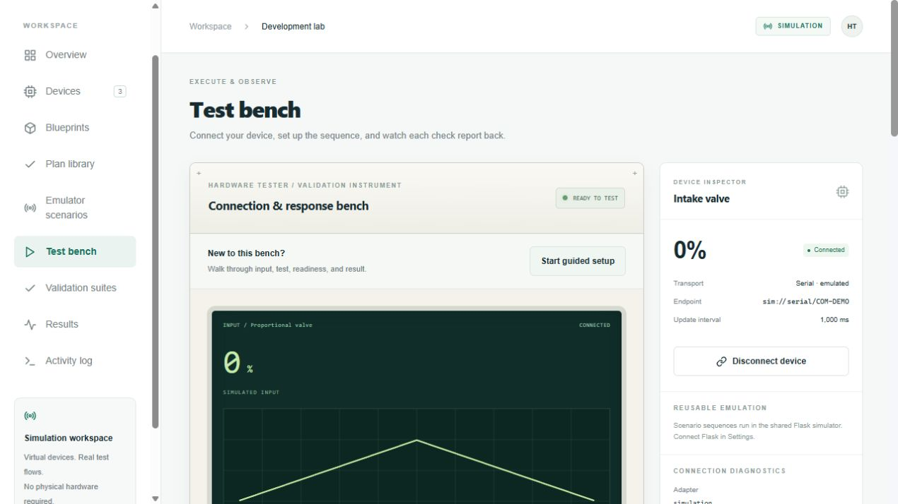
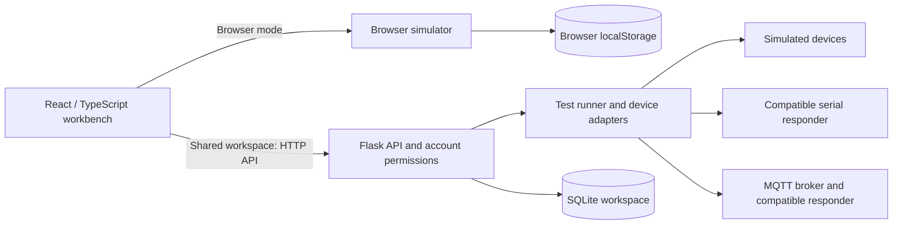

# Hardware Tester

### A shared workbench for device testing, simulation, and repeatable validation

Hardware Tester connects a React interface to a Python/Flask test engine so you can configure devices, run test plans, inspect failures, and compare results. Start with simulated devices; explore serial and MQTT integration when a compatible device or mock responder is available.

**Built by [Gary Will](https://github.com/everyones-guy)** · Systems integration, backend engineering, and automation

[Quick start](QUICKSTART.md) · [Detailed workbench guide](WORKBENCH.md) · [Five-minute walkthrough](#five-minute-project-walkthrough)

## See the workbench



*Browser simulator demonstration. The screenshot shows simulated behavior, not measurements from physical hardware.*

## What it does

- Connects test workflows, device profiles, configuration, telemetry, and recorded results in one interface.
- Provides a browser-only simulator and a shared Flask workspace with SQLite persistence.
- Supports reusable test plans, emulator scenarios, validation suites, logs, and result comparisons in the shared workspace.
- Exercises serial/MQTT adapters through explicit connections and a documented request/response protocol.
- Separates viewer, operator, and administrator permissions in the authenticated Flask workspace.

## Run the current application

### Recommended: Docker Compose

Install Git and Docker Desktop with its **Linux container engine** running. From a terminal:

```powershell
git clone https://github.com/everyones-guy/HardwareTester.git
cd HardwareTester
docker compose up --build -d --wait --wait-timeout 180
```

Open **[http://localhost:8080](http://localhost:8080)**, create your first administrator account, then choose **Test bench → Start guided setup** for a simulated test. There is no default administrator password.

The stack includes React/nginx, Flask, a local Mosquitto broker, and a mock MQTT valve. No host Python or Node installation is required for this route. Ports 8080 (web) and 1883 (MQTT) bind to loopback by default.

Stop the bench with `docker compose stop`. Restart with the startup command above. `docker compose down` removes the containers but preserves saved workspace data in the `lab-data` volume; adding `--volumes` deletes that data.

For a transport demonstration, add a valve using `mqtt://broker:1883/lab/demo-valve`, connect it explicitly, and run **Control response**. This exercises MQTT through the included mock responder; it does not establish physical-device compatibility.

### Local development

Requires **Node.js 22.12+**, **Python 3.11+**, and PowerShell. From the repository root, run these in separate terminals:

```powershell
.\start-backend.ps1
```

```powershell
.\start-workbench.ps1
```

Open **[http://localhost:5173](http://localhost:5173)**. Use **Workspace settings → Connect Flask backend** for the shared workspace. The browser simulator is a separate local workspace; switching engines does not migrate its data.

See [QUICKSTART.md](QUICKSTART.md) for installation and release checks, and [WORKBENCH.md](WORKBENCH.md) for configuration and transport details.

## Architecture at a glance



In Docker, nginx serves the frontend and proxies `/api/` to Flask. Flask owns shared test execution and persistence; a server test can continue after the browser closes. One backend owner process manages the test/transport lifecycle for each SQLite workspace. Browser simulation runs independently and cannot control the shared server's hardware.

## Five-minute project walkthrough

1. **Explain the problem.** Device testing involves more than sending a command: configuration, connection state, expected behavior, failure diagnosis, and repeatability all matter.
2. **Show a healthy test.** Start guided setup, choose a simulated device and compatible plan, connect it, and review readiness before running. Open the result and explain expected versus observed values.
3. **Make failure visible.** On a simulated device, inject **Transport timeout** or **Out-of-range reading**, rerun, and inspect the failed check and related logs. Clear the fault afterward.
4. **Show a control workflow.** On a simulated valve or relay, run **Control response** and inspect the command, verification, and restoration outcome. Keep this demonstration on simulated devices or the included mock fixture.
5. **Connect the architecture to the behavior.** Explain which work happens in React, which happens in Flask, and how adapters keep transport-specific details separate. In Flask mode, reload to show retained results; contrast this with the separate browser-only workspace.

For a recorded demo, narrate the problem, one passing test, one expected failure, and the architecture. Use a disposable simulation workspace with no personal account or device information visible. A failure you can explain is more informative than a screen full of green checks.

## Verify changes

From the repository root:

```powershell
.\regression.ps1
```

This runs the project's backend, formatting, simulator, build, browser, integration, and account-permission checks. Dependencies and Playwright browser setup are described in [WORKBENCH.md](WORKBENCH.md#verification).

With Docker Desktop running, the clean-install check is:

```powershell
.\release-check.ps1
```

It creates disposable stacks and volumes for installation, MQTT, persistence, and archive-recovery checks. It does not prove compatibility with physical hardware. See [QUICKSTART.md](QUICKSTART.md#check-a-release-from-a-clean-installation) for isolation and retained diagnostics.

## Scope and current limits

- This is a local test workbench foundation. Production multiuser deployment and arbitrary hardware compatibility are not claimed.
- Serial and MQTT devices must implement the documented JSON protocol. Generic USB devices are not supported by these adapters.
- Physical-device validation, device-specific adapters, and TLS/authenticated MQTT remain separate work.
- A physical command's outcome can be uncertain after a transport failure or server crash; inspect the restoration result and device state.
- The original application is retained as reference material. Legacy factories, installers, Docker files, and older dashboard features are not the current default stack. PostgreSQL, Kubernetes, and a separate WSL shell are unnecessary for the current workbench.

## Explore the code

| Area | Start here |
| --- | --- |
| Frontend workbench | [`frontend/src/workbench/`](frontend/src/workbench/) |
| Backend and test engine | [`backend/`](backend/) |
| Deployment and fixture configuration | [`deployment/`](deployment/), [`docker-compose.yml`](docker-compose.yml) |
| Detailed behavior and APIs | [`WORKBENCH.md`](WORKBENCH.md) |

Questions or reproducible problems? [Open an issue](https://github.com/everyones-guy/HardwareTester/issues).

## License

[MIT](LICENSE.txt).
